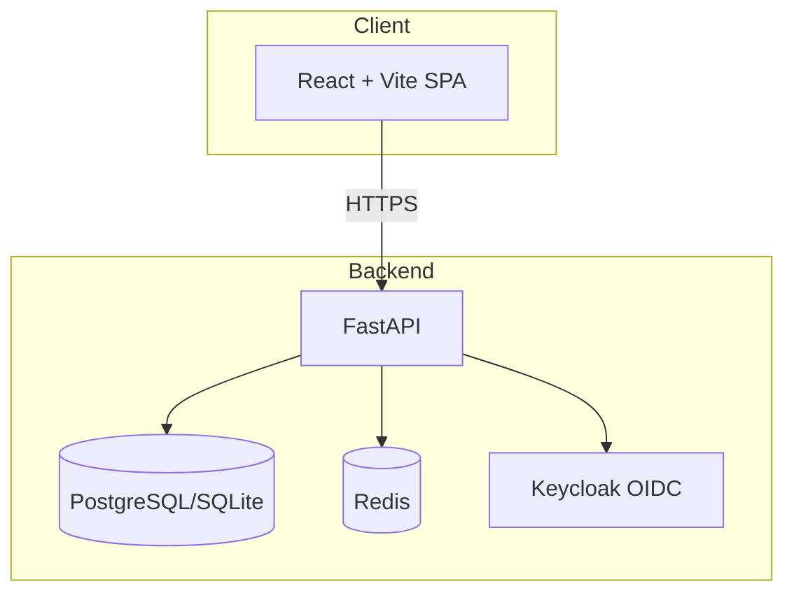

# Beacon Console — Ryan Vo

> Work in progress. This checkpoint may be incomplete or fail tests. See PLAN.md and STATUS.md before use.


**Ryan Vo | AI & Machine Learning**

Beacon Console is a full-stack platform for managing and executing validated scientific agent skills. It turns any AI agent into an AI Scientist by providing a curated library of skills covering statistical genetics, field onboarding, literature analysis, and more — compatible with Cursor, Claude Code, Codex, Pi, Antigravity, and the open Agent Skills standard.

## Problem

Researchers working with AI agents lack a standardized way to discover, configure, and execute validated scientific workflows. Existing agent skill libraries are fragmented, lack authentication, and don't provide deterministic execution environments for reproducibility.

## Approach

Beacon Console provides:
- **Skill Catalog**: Browse, search, and manage validated scientific skills with versioned schemas
- **Execution Engine**: Run skills with deterministic offline cores; opt-in LLM explanations labeled advisory
- **OIDC Authentication**: Secure Keycloak-based auth with role-based access (viewer/operator/admin)
- **Statistical Genetics Workflow**: Locus compare plots (GWAS + eQTL + LD + rendering) from Issue #197
- **Field Onboarding Workflow**: Guided ladder progression for unfamiliar research fields from Issue #302

## Quick Start

### Prerequisites
- Docker and Docker Compose
- Or: Python 3.12+, Node 24+, PostgreSQL 16+, Redis 7+, Keycloak 25+

### Docker Compose (Recommended)

```bash
cp .env.example .env
# Edit .env with your settings
docker compose up -d
```

Services:
- Frontend: http://localhost:3000
- Backend API: http://localhost:8000
- API Docs: http://localhost:8000/docs
- Keycloak: http://localhost:8080 (admin/admin)

### Local Development

**Backend:**
```bash
cd backend
python -m venv .venv
source .venv/bin/activate
pip install -r requirements.txt
cp ../.env.example .env
# Edit .env
uvicorn app.main:app --reload --host 127.0.0.1 --port 8000
```

**Frontend:**
```bash
cd frontend
npm install
npm run dev
```

**Run Tests:**
```bash
# Backend
cd backend && .venv/bin/python -m pytest tests/ -v

# Frontend
cd frontend && npm test
```

## Architecture



## API Endpoints

| Method | Path | Description | Auth |
|--------|------|-------------|------|
| GET | `/api/health` | Health check | Public |
| GET | `/api/health/db` | Health check with DB | Public |
| GET | `/api/auth/login` | Initiate OIDC login | Public |
| GET | `/api/auth/callback` | OIDC callback | Public |
| POST | `/api/auth/logout` | Logout | Cookie |
| GET | `/api/auth/me` | Current user | Cookie |
| GET | `/api/auth/csrf` | Get CSRF token | Cookie |
| GET | `/api/skills` | List skills (paginated, filtered) | Cookie |
| GET | `/api/skills/{id}` | Get skill detail | Cookie |
| POST | `/api/skills` | Create skill | Operator+ |
| PATCH | `/api/skills/{id}` | Update skill | Operator+ |
| DELETE | `/api/skills/{id}` | Delete skill | Admin |
| GET | `/api/executions` | List executions | Cookie |
| GET | `/api/executions/{id}` | Get execution detail | Cookie |
| POST | `/api/executions` | Create execution | Cookie |
| POST | `/api/executions/{id}/run` | Run execution | Cookie |

## Security

- **Authentication**: OIDC Authorization Code + PKCE via Keycloak
- **Session**: HttpOnly SameSite=Lax cookies with CSRF protection
- **Authorization**: Role-based (viewer/operator/admin) on all data endpoints
- **Tokens**: Never logged; access tokens validated via JWKS
- **Secrets**: `.env` only; no credentials in repo
- **Demo Mode**: Binds to 127.0.0.1; refuses in production

### Keycloak SAML Broker Setup

Keycloak supports upstream SAML IdPs through identity brokering. To configure:

1. In Keycloak Admin Console → Identity Providers → Add SAML v2.0
2. Configure IdP metadata/entity ID/SSO URL
3. Add mappers for email, username, roles
4. Set "First Broker Login" flow to link/update local accounts
5. Update `OIDC_ISSUER_URL` if realm changes

## LLM Provider Configuration

| Provider | Base URL | Notes |
|----------|----------|-------|
| OpenAI | `https://api.openai.com/v1` | Default |
| Anthropic | `https://api.anthropic.com` | Messages API |
| Gemini | `https://generativelanguage.googleapis.com` | generateContent |
| Ollama | `http://localhost:11434/v1` | Local models |
| LiteLLM | `http://localhost:4000` | Proxy for multiple |
| OpenRouter | `https://openrouter.ai/api/v1` | Multi-provider |

Set `LLM_API_KEY`, `LLM_PROVIDER`, `LLM_MODEL`, `LLM_BASE_URL` in environment.

## Deployment

### TLS Reverse Proxy (Required for Production)

```nginx
server {
    listen 443 ssl http2;
    server_name beacon.example.com;

    ssl_certificate /path/to/cert.pem;
    ssl_certificate_key /path/to/key.pem;

    location / {
        proxy_pass http://127.0.0.1:3000;
        proxy_set_header Host $host;
        proxy_set_header X-Real-IP $remote_addr;
        proxy_set_header X-Forwarded-For $proxy_add_x_forwarded_for;
        proxy_set_header X-Forwarded-Proto $scheme;
    }

    location /api/ {
        proxy_pass http://127.0.0.1:8000/;
        proxy_set_header Host $host;
        proxy_set_header X-Real-IP $remote_addr;
        proxy_set_header X-Forwarded-For $proxy_add_x_forwarded_for;
        proxy_set_header X-Forwarded-Proto $scheme;
    }

    location /auth/ {
        proxy_pass http://127.0.0.1:8000/;
        proxy_set_header Host $host;
        proxy_set_header X-Real-IP $remote_addr;
        proxy_set_header X-Forwarded-For $proxy_add_x_forwarded_for;
        proxy_set_header X-Forwarded-Proto $scheme;
    }
}
```

### Backup/Restore

```bash
# Backup PostgreSQL
docker exec beacon-postgres pg_dump -U beacon beacon > backup.sql

# Restore
docker exec -i beacon-postgres psql -U beacon beacon < backup.sql

# Backup Keycloak
docker exec beacon-keycloak /opt/keycloak/bin/kc.sh export --file /tmp/export.json --realm beacon
docker cp beacon-keycloak:/tmp/export.json ./keycloak-backup.json
```

## AI/ML Evaluation

### Implemented Workflows

1. **Locus Compare (Statistical Genetics)**: Four-primitive pipeline — GWAS Catalog fetch → eQTL Catalogue fetch → 1000 Genomes LD compute → 4-panel locus compare render. Deterministic core with real data schemas.
2. **Field Onboarding**: Five-rung ladder — Prerequisites → Maturity → Motivation → Vocabulary → Framework → Methods → Frontier. Decode mode for passage analysis.

### Reproducible Baseline

```bash
# Run locus compare test
cd backend
.venv/bin/python -m pytest tests/test_locus_compare.py -v

# Run field onboarding test
.venv/bin/python -m pytest tests/test_field_onboarding.py -v
```

### Limitations

- LLM explanations are opt-in advisory only; deterministic core works offline
- GWAS/eQTL/LD fetches require network access; mocked in tests
- Field onboarding coverage strongest in physics/ML; other disciplines thin
- No real benchmark numbers — all measurements from actual test runs

## License

MIT License — Copyright (c) 2026 Ryan Vo <ryandtvo@gmail.com>

## Changelog

See [CHANGELOG.md](CHANGELOG.md)